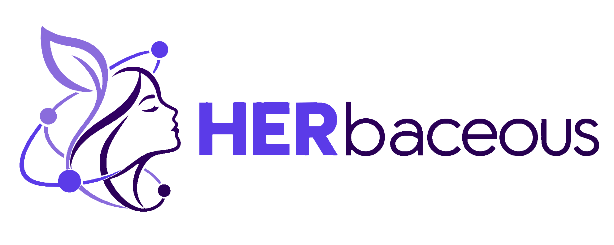

 <picture> <source media="(prefers-color-scheme: dark)" srcset="IT-Product-Build/Frontend/src/assets/Herbaceous-Dark-Text.svg"> <source media="(prefers-color-scheme: light)" srcset="IT-Product-Build/Frontend/src/assets/Herbaceous-Light-Text.svg">  </picture>

Mentorship is advice. Herbaceous builds the advocacy. 🌱

  

React Tailwind Express Prisma PostgreSQL AWS Flask

Problem Statement:

Only 17.4% of Australians with a STEM qualification are women, and women hold just 16.3% of STEM CEO roles. Most mentoring stops at advice like "find a mentor" or "network more", which does little to help women stay in STEM and move up.

Proposed Solution:

Herbaceous matches mentees with verified mentors using an explainable compatibility score, keeps the relationship going with one small check-in a week, and lets mentees ask for real advocacy: referrals, introductions, nominations and endorsements. Every request is tracked until it's done, so guidance turns into actual opportunities.

Application Images:

Home STEM Insights Dashboard

  

Mentor Matching Weekly Planner Advocacy

  

How It Works:

flowchart LR
U["Mentors & mentees"] --> UI["React frontend (S3 + CloudFront)"]
UI --> AUTH["AWS Cognito"]
UI --> API["Express API"]
API --> DB[("PostgreSQL")]
API --> AI["Flask matching service"]
AI --> GEMINI["Google Gemini"]

Frontend:

Built with React, Vite and Tailwind, with Framer Motion and GSAP for animation and Recharts and D3 for the STEM data visualisations. Light and dark themes, fully responsive.

Backend:

An Express API with Prisma on PostgreSQL (Neon), secured with AWS Cognito. Transactions guarantee one active mentorship per mentee, and nothing is ever hard deleted.

Matching & AI:

A Python Flask service scores mentors across five factors: field, goals, experience, availability and style. Every score shows its reasons. Gemini is used only to read employment dates from a resume the mentor has consented to share, never to decide a match.

Privacy:

No real names or emails are collected. Resumes stay in memory and only the verified result is stored.

 
<b>Run it locally</b>
  

Needs Node 24+, Python 3.11+, a PostgreSQL database and an AWS Cognito user pool. Copy the .env.example in each folder and fill in your values.

# API

cd IT-Product-Build/Backend
npm ci && npx prisma migrate deploy && node prisma/seed.js
npm run dev

# Frontend

cd IT-Product-Build/Frontend
npm ci && npm run dev

# Matching service (optional, the API has a local fallback)

cd AI-Build
pip install -r requirements.txt && python app.py

Our Goals 🎯

Herbaceous is built around UN SDG 5: Gender Equality and SDG 4: Quality Education. Getting women into STEM is only half the job. Keeping them there and opening doors for them is the other half, and that's where we focus.

The Story of Herbaceous

Herbaceous plants grow fast, but they grow best with something to lean on. That felt like the right picture for what mentorship should be: not a one-off chat, but steady support that helps someone climb. Our logo shows exactly that, two women helping each other up a branching STEM plant.

Creator :zap:

<table> <tr> <td align="center"> <b>Palash Rambhia</b> <a href="https://github.com/Palash2911">💻🌱🚀</a></td> </tr> </table> 

 

Rooted in connection. Growing through advocacy.

